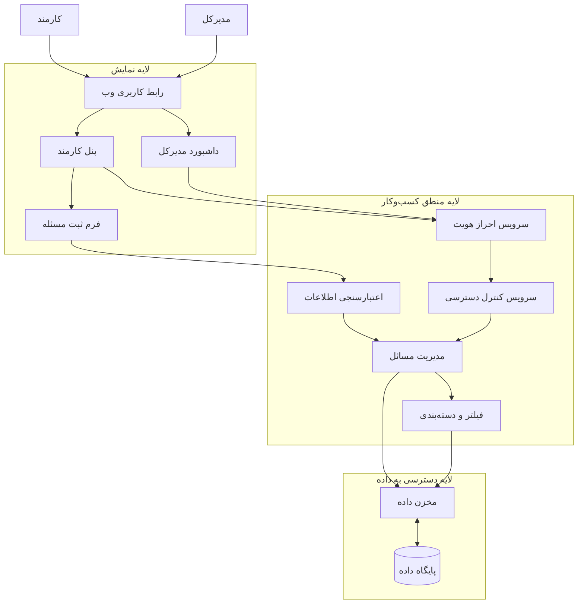

# مستند معماری سیستم بازتاب (Baztab)

**نام پروژه:** سامانه بازتاب – پلتفرم بازخورد کارکنان  
**سبک معماری:** معماری لایه‌ای سه‌لایه (Three-Tier Layered Architecture)  
**نسخه:** ۱.۰  
**وضعیت:** پیشنهادی

---

## ۱. مقدمه

سامانه بازتاب با هدف ایجاد بستری برای ثبت و مشاهده مسائل و دغدغه‌های کارکنان در محیط کار طراحی شده است.

برای طراحی معماری این سامانه از الگوی معماری لایه‌ای سه‌لایه استفاده می‌شود. در این معماری، مسئولیت‌های سیستم به سه لایه اصلی تقسیم می‌شوند:

۱. لایه نمایش (Presentation Layer)  
۲. لایه منطق کسب‌وکار (Business Logic Layer)  
۳. لایه دسترسی به داده (Data Access Layer)

این تفکیک باعث جداسازی مسئولیت‌ها، افزایش قابلیت نگهداری و ساده‌تر شدن توسعه سیستم می‌شود.

## ۲. نمای کلی معماری سیستم

نمودار زیر ارتباط کاربران، اجزای اصلی سیستم و لایه‌های معماری را نشان می‌دهد.

## ۳. معرفی لایه‌های معماری

### ۳.۱. لایه نمایش (Presentation Layer)

این لایه مسئول برقراری ارتباط بین کاربران و سیستم است. کاربران از طریق رابط کاربری با امکانات سامانه تعامل می‌کنند.

**اجزای اصلی:**
- پنل کارمند
- داشبورد مدیرکل
- فرم ثبت مسئله
- صفحات ورود و احراز هویت

**مسئولیت‌ها:**
- نمایش اطلاعات به کاربران
- دریافت اطلاعات واردشده توسط کاربران
- ارسال درخواست‌ها به لایه منطق کسب‌وکار
- نمایش نتایج عملیات و پیام‌های خطا

### ۳.۲. لایه منطق کسب‌وکار (Business Logic Layer)

این لایه هسته اصلی پردازش سیستم است و مسئول اجرای قوانین و منطق کسب‌وکار سامانه بازتاب است.

**اجزای اصلی:**
- سرویس احراز هویت
- سرویس کنترل دسترسی
- بخش اعتبارسنجی اطلاعات
- سرویس مدیریت مسائل
- سرویس فیلتر و دسته‌بندی

**مسئولیت‌ها:**
- بررسی اطلاعات ورود کاربران
- تشخیص نقش و سطح دسترسی کاربران
- اعتبارسنجی اطلاعات ثبت‌شده
- مدیریت ثبت مسائل جدید
- بازیابی مسائل ثبت‌شده توسط هر کارمند
- بازیابی اطلاعات تجمیعی برای مدیرکل
- فیلتر مسائل بر اساس واحد سازمانی

### ۳.۳. لایه دسترسی به داده (Data Access Layer)

این لایه مسئول برقراری ارتباط بین منطق برنامه و پایگاه داده است.

**اجزای اصلی:**
- مخزن داده (Repository)
- پایگاه داده (Database)

**مسئولیت‌ها:**
- ذخیره اطلاعات کاربران
- بازیابی اطلاعات کاربران
- ذخیره مسائل ثبت‌شده
- بازیابی مسائل بر اساس درخواست‌های مجاز
- مدیریت اطلاعات واحدهای سازمانی و نقش‌های کاربران

## ۴. مسئولیت اجزای اصلی سیستم

| جزء سیستم | مسئولیت |
|---|---|
| پنل کارمند | ثبت مسئله و مشاهده مسائل شخصی |
| داشبورد مدیرکل | مشاهده مسائل ثبت‌شده در سازمان |
| سرویس احراز هویت | بررسی صحت اطلاعات ورود |
| سرویس کنترل دسترسی | اعمال محدودیت‌های دسترسی بر اساس نقش |
| اعتبارسنجی اطلاعات | بررسی صحت اطلاعات ورودی |
| مدیریت مسائل | مدیریت عملیات ثبت و بازیابی مسائل |
| فیلتر و دسته‌بندی | فیلتر مسائل بر اساس واحد سازمانی |
| مخزن داده | مدیریت ارتباط با پایگاه داده |
| پایگاه داده | ذخیره‌سازی دائمی اطلاعات سیستم |

## ۵. نحوه ارتباط و جریان اطلاعات بین لایه‌ها

### ۵.۱. فرایند ثبت مسئله توسط کارمند

۱. کارمند وارد سامانه می‌شود.  
۲. اطلاعات ورود توسط سرویس احراز هویت بررسی می‌شود.  
۳. کارمند اطلاعات مسئله را در فرم مربوطه وارد می‌کند.  
۴. اطلاعات به لایه منطق کسب‌وکار ارسال می‌شود.  
۵. اطلاعات ورودی اعتبارسنجی می‌شوند.  
۶. سرویس مدیریت مسائل درخواست ثبت را پردازش می‌کند.  
۷. مخزن داده اطلاعات را در پایگاه داده ذخیره می‌کند.  
۸. نتیجه عملیات به کارمند نمایش داده می‌شود.

### ۵.۲. فرایند مشاهده مسائل توسط کارمند

۱. کارمند وارد سامانه می‌شود.  
۲. درخواست مشاهده مسائل شخصی خود را ارسال می‌کند.  
۳. سطح دسترسی کاربر بررسی می‌شود.  
۴. سرویس مدیریت مسائل درخواست را پردازش می‌کند.  
۵. مخزن داده مسائل متعلق به همان کارمند را بازیابی می‌کند.  
۶. اطلاعات در پنل کارمند نمایش داده می‌شوند.

### ۵.۳. فرایند مشاهده مسائل توسط مدیرکل

۱. مدیرکل وارد سامانه می‌شود.  
۲. درخواست مشاهده داشبورد را ارسال می‌کند.  
۳. سطح دسترسی مدیرکل بررسی می‌شود.  
۴. سرویس مدیریت مسائل اطلاعات موردنیاز را درخواست می‌کند.  
۵. سرویس فیلتر، اطلاعات را بر اساس واحد سازمانی دسته‌بندی می‌کند.  
۶. مخزن داده اطلاعات موردنیاز را از پایگاه داده بازیابی می‌کند.  
۷. نتایج در داشبورد مدیرکل نمایش داده می‌شوند.

## ۶. امنیت و کنترل دسترسی

امنیت اطلاعات یکی از الزامات اصلی معماری سامانه بازتاب است.

سیستم از کنترل دسترسی مبتنی بر نقش (RBAC) استفاده می‌کند.

**سطح دسترسی کارمند:**
- ثبت مسئله جدید
- مشاهده مسائل ثبت‌شده توسط خودش

**سطح دسترسی مدیرکل:**
- مشاهده مسائل ثبت‌شده در تمام واحدهای سازمانی
- فیلتر مسائل بر اساس واحد سازمانی

تمام محدودیت‌های دسترسی باید در لایه منطق کسب‌وکار اعمال شوند و صرفاً مخفی کردن اطلاعات در رابط کاربری کافی نیست.

سیستم باید از دسترسی غیرمجاز کاربران به مسائل سایر کارکنان، حتی از طریق ارسال مستقیم درخواست به سرویس‌ها، جلوگیری کند.

## ۷. مسئولیت پایگاه داده

پایگاه داده وظیفه نگهداری دائمی اطلاعات اصلی سامانه را بر عهده دارد.

موجودیت‌های اصلی اطلاعاتی عبارت‌اند از:

- کاربران
- نقش‌های کاربری
- واحدهای سازمانی
- مسائل ثبت‌شده

تمام عملیات ذخیره‌سازی و بازیابی اطلاعات از طریق لایه دسترسی به داده انجام می‌شوند.

## ۸. دلایل انتخاب معماری سه‌لایه

دلایل انتخاب این معماری برای سامانه بازتاب عبارت‌اند از:

۱. جداسازی مسئولیت‌های مختلف سیستم  
۲. ساده‌تر شدن توسعه و نگهداری نرم‌افزار  
۳. امکان تست مستقل بخش‌های مختلف  
۴. متمرکز شدن قوانین کسب‌وکار و کنترل دسترسی  
۵. امکان توسعه و افزودن قابلیت‌های جدید در آینده  
۶. تناسب با ابعاد و نیازمندی‌های نسخه اولیه سامانه (MVP)

## ۹. محدوده معماری در نسخه اولیه (MVP)

معماری پیشنهادی در نسخه اولیه سامانه، قابلیت‌های زیر را پوشش می‌دهد:

- احراز هویت کاربران
- کنترل دسترسی مبتنی بر نقش
- ثبت مسائل توسط کارکنان
- مشاهده مسائل شخصی توسط کارکنان
- مشاهده تجمیعی مسائل توسط مدیرکل
- فیلتر مسائل بر اساس واحد سازمانی

قابلیت‌هایی مانند پیگیری وضعیت مسائل، ارجاع به مسئول و مدیریت فرایند حل مسئله خارج از محدوده نسخه اولیه هستند.
