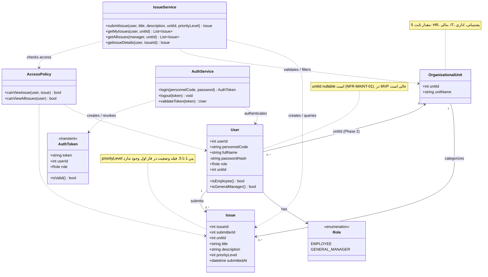

# Class Diagram — بازتاب (Baztab)

نمودار کلاس فاز اول (MVP) بر اساس SRS، ERD و نمودارهای فعالیت.

## ردیابی به اپیک‌ها

| اپیک | کلاس / متد |
|---|---|
| EPIC-AUTH | `AuthService.login / logout / validateToken`، `AuthToken`، `Role` |
| EPIC-ISSUE | `IssueService.submitIssue`، `Issue`، `OrganizationalUnit` |
| EPIC-MY-ISSUES | `IssueService.getMyIssues`، `IssueService.getIssueDetails` |
| EPIC-GM-DASH | `IssueService.getAllIssues` |
| FR-PRIV-01 | `AccessPolicy.canViewIssue / canViewAllIssues` |
| NFR-MAINT-01 | `User.unitId` (nullable) |

## تصمیم‌های طراحی

- `Role` به‌صورت enum است تا افزودن «مدیر واحد» در فاز ۲ ساده باشد.
- `AccessPolicy` قاعده‌ی محرمانگی (FR-PRIV-01) را در یک نقطه متمرکز می‌کند.
- `AuthToken` ذخیره نمی‌شود، چون ERD جدول نشست ندارد.
- فیلد وضعیت و رابطه‌ی `managed_by` عمداً خارج از MVP هستند.
